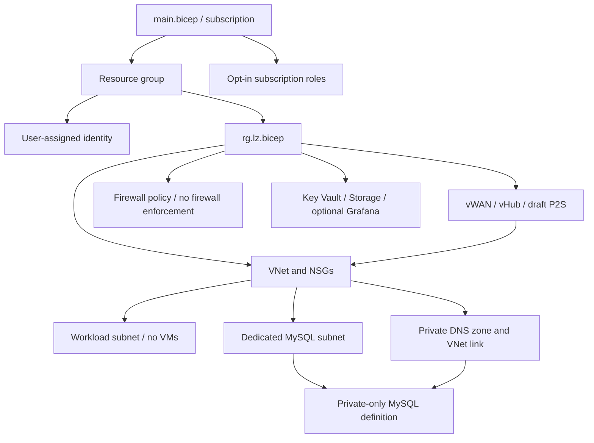

# Architecture and boundaries

The subscription entry uses a separate resource-group-scoped identity module;
its output supplies the principal for opt-in role assignments. Role arrays are
empty in the synthetic examples. There is no automatic broad grant in them.

`mysqlSubnetName` is passed explicitly through main → RG → network. The same
value selects the delegation and constructs the subnet ID used by MySQL. The
Python contract checker rejects a missing subnet, workload-subnet delegation,
overlap, an out-of-VNet subnet, and undersized MySQL address space. This checker
is an offline prerequisite, not an ARM runtime policy.

The firewall policy mapper uses Bicep `map` lambdas instead of unsupported nested
`for` expressions. Optional FQDN fields and absent collection arrays become empty
arrays. Compilation does not validate every semantic rule combination supplied
inside untyped objects.

Reference: [Bicep lambda functions](https://learn.microsoft.com/en-us/azure/azure-resource-manager/bicep/bicep-functions-lambda).

`mysqlPrivateDnsZoneName` flows through main → RG → `mysqlDns`. Its zone ID
and the network subnet ID are consumed by MySQL, so the compiled graph depends
on both modules. The link uses the workload VNet and disables autoregistration.
No manually invented A record is created. This does not test DNS resolution,
VPN forwarding, Azure provisioning or database access. Grafana uses a typed API
and reads its actual endpoint; it remains disabled in both examples.
